<h1 align="center">GK2 HUD+</h1>

<p align="center">
  Quality-of-life mods for <b>Graveyard Keeper 2</b>, in one plugin.<br>
  More numbers, more context, a better map and a calendar. It looks like the game made it.
</p>

<p align="center">
  
</p>

- **Looks native.** Every window, tooltip and label is built from the game's own UI: same fonts, frames, colors and
  pixel grid. Nothing floats on top of the game looking like a debug overlay.
- **No spoilers.** The mod only shows what your save has already revealed: explored map areas, visited places, events
  you have heard about. This is checked against an index of what unlocks what in the game, not guessed from names.
- **Information first.** By default nothing changes the rules of the game. The two features that do (Save/Load and
  zombie perk refund) ship turned off.
- **Everything toggles live.** Each feature turns on and off from the pause menu, without restarting.
- **English and Brazilian Portuguese**, following the game's language.

## Features

### Tooltips

| Richer tooltips | Tooltips in the world |
| :---: | :---: |
|  | 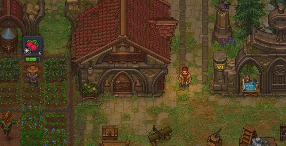 |
| More numbers on items, stations and characters. Middle click pins a tooltip; highlighted terms open another one inside it. | Rest the mouse on a craft, a garden bed or a body to see what is going on and how long is left. |

### Map

| Zoom | Look inside places |
| :---: | :---: |
| 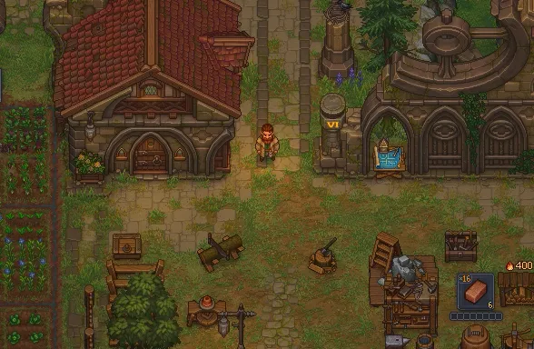 |  |
| Mouse wheel zoom in four pixel-perfect levels, anchored on the cursor. One more step goes down to the world itself. | Zoom into a yellow arrow to peek inside a place you have visited. Doors and stairs lead further in; hover an object to inspect it. |

| Order details |
| :---: |
| 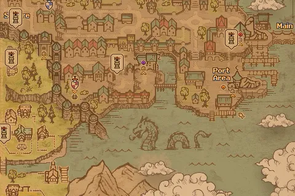 |
| Hover the town orders icon to see the item of each order, how much is delivered and the reward. |

### Calendar and journal

| Time and week on the medallion | Week as a carousel (option) |
| :---: | :---: |
|  | 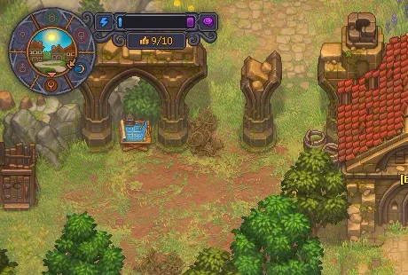 |
| Hover the day medallion to see the time and the week ahead; hover a sigil for that day. | The same week in one row that slides as the day goes by. |

| Calendar tab | Journal |
| :---: | :---: |
|  | 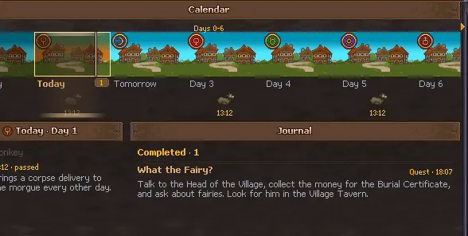 |
| A calendar page in the TAB window, with the days and their events. | A diary of what you unlocked and finished each day. |

### Quest tree

<p align="center"></p>

NPC names on the quest tree. Click a quest to read how you got there.

### HUD

| HUD numbers | Show the maximum (option) | Day plate (option) | Turning medallion |
| :---: | :---: | :---: | :---: |
| 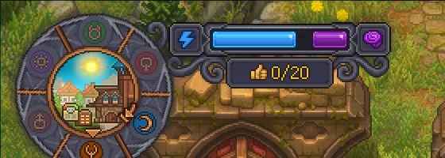 | 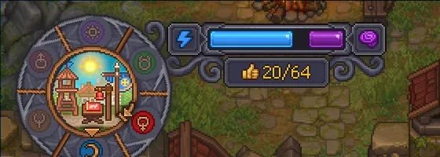 | 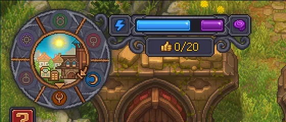 | 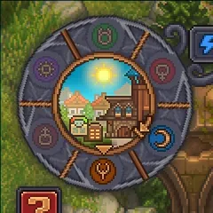 |
| Numbers on the energy and insanity bars. | The maximum too, like 120/150. | A small plate with the day and time. | The day medallion turns slowly as the hours pass. |

### Gameplay (off by default)

These two change the state of the game, so they start turned off.

| Save and Load in the pause menu | Zombie perk refund |
| :---: | :---: |
| 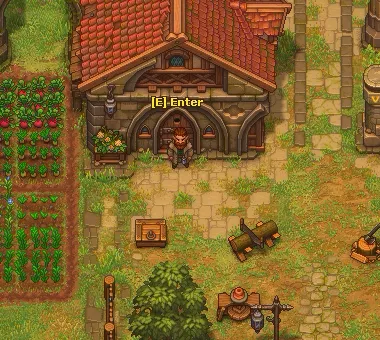 | 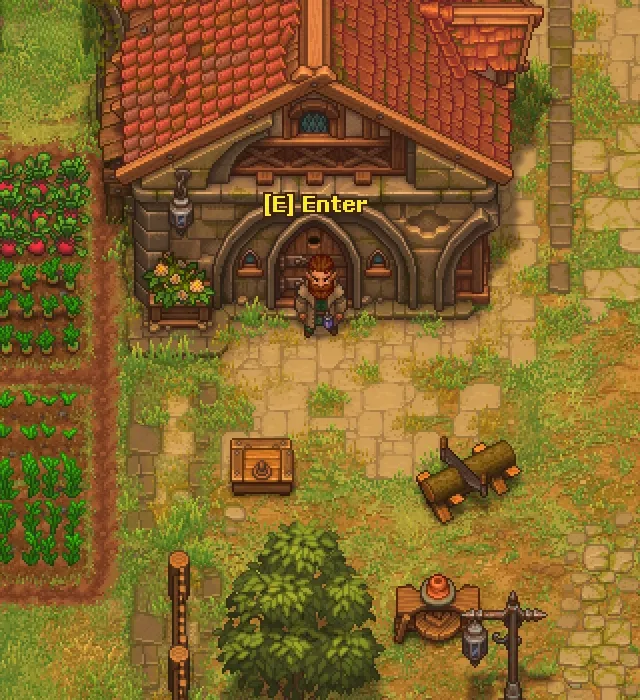 |
| The game only saves when you wake up. Save works whenever the game is free (no dialog, fight, sleep or work going on); Load lists the current save, the game's backups and the mod's own history. | Right-click a bought zombie perk to get its points back, one perk at a time. |

### The menu

<p align="center">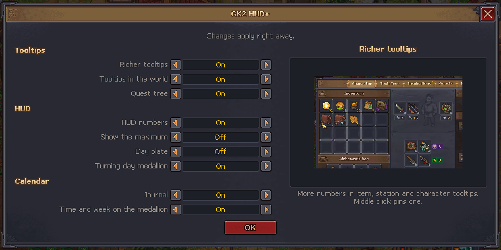</p>

A **GK2 HUD+** button in the pause menu opens the list of features. Each one has a short clip of itself in action and
turns on or off on the spot. Settings live in `BepInEx/config/mullervgs.gk2.hudplus.cfg`.

## Install

Graveyard Keeper 2 ships its own mod loader (BepInEx 5), so there is nothing else to install.

**Steam Workshop** (recommended): subscribe to GK2 HUD+ and start the game. The game installs and updates the mod by
itself.

**Manual**:

1. Download `GK2HudPlus-<version>.zip` from [Releases](../../releases).
2. Unzip it into the game's save data folder, so that you end up with
   `%USERPROFILE%\AppData\LocalLow\Lazy Bear Games\Graveyard Keeper 2\Mods\Code\GK2HudPlus\modinfo.json`.
3. Start the game.

Either way, the mod shows up in the game's Mods window and as a **GK2 HUD+** button in the pause menu.

Steam Deck and Linux (Proton): set the game's launch options to `WINEDLLOVERRIDES="winhttp=n,b" %command%`, as the
game asks for any BepInEx plugin.

To remove it, unsubscribe or delete the `GK2HudPlus` folder. Your settings stay in `BepInEx/config`.

## After a game update

Each feature runs isolated: if a game update breaks one, that feature turns itself off with an in-game notice and the
rest keeps working. Turn it off and on again in the menu to retry, and please [open an issue](../../issues) with your
`Player.log`.

## How it is built

The repository is also a record of how the mod is made, almost entirely by AI coding agents working against a second
copy of the game. The full guide the agents follow is in [AGENTS.md](AGENTS.md) (in Portuguese).

- **Blue-green.** *Blue* is the copy being played; *green* is an isolated copy (own saves, own registry key) where
  agents build and test. A mod only reaches blue after its screenshots are approved.
- **A bridge into the game.** A development-only plugin exposes the running game over local HTTP: hot-reload a
  build in about 2 seconds, run C# scenarios inside the game, dump the native UI tree, take screenshots.
- **Screenshots or it did not happen.** Every visible change ends with a screenshot judged against the native screen it
  imitates: font, 2 px grid, 9-slice frames, palette, spacing.
- **Spoiler barrier.** `gk2 check` indexes every script and dialogue graph of the game to know what unlocks what, and
  fails the build if the mod could show something the save has not revealed.
- **Clips that cannot go stale.** The clips on this page and in the in-game menu are recorded by scripted demos. Each
  one is tied to the hash of the code it shows; change the code and the build fails until the clip is re-recorded.
- **Measured cost.** Frame time, GC and the cost of each feature go to a metrics dashboard. HUD+ takes about 0.5% of a
  frame.

| Project | What |
| --- | --- |
| `GK2HudPlus/` | **GK2 HUD+**: the package, with the feature list and the menu |
| `GK2Hud/` | tooltips, HUD numbers, medallion, calendar, journal, quest tree |
| `GK2Map/` | map zoom, place view, inspection, orders |
| `GK2Saves/` | Save and Load in the pause menu, save history |
| `GK2ZombieRefund/` | zombie perk refund |
| `GK2Insight/` | debug tool: in-game panels, data dump and telemetry (not part of the package) |
| `GK2DevBridge/`, `GK2HotLoader/` | development bridge and live delivery of approved builds |
| `Shared/` | ModGuard (isolated parts), ModHost (feature list), plugin swap at runtime |
| `tools/` | `gk2` CLI, clip recorder, spoiler check, game update routine |
| `docs/cenarios/` | C# scenarios run inside the game |

## Build from source

Needs the game, Docker and a Linux shell (developed on WSL). `tools/gk2` builds against the game's assemblies inside
a .NET SDK container; paths to the game are at the top of the script.

```
gk2 package GK2HudPlus     # dist/GK2HudPlus-<version>.zip
```

## License

[MIT](LICENSE). The font used in the trailer captions (Jersey 10) is under the SIL Open Font License, in
`tools/rec/fonts/`.

## Disclaimer

Unofficial fan project, not affiliated with Lazy Bear Games. Graveyard Keeper 2 and its art belong to their owners;
the clips here show the game with the mod running.
