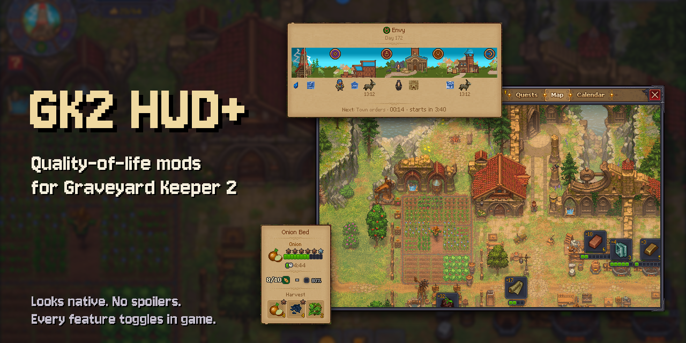
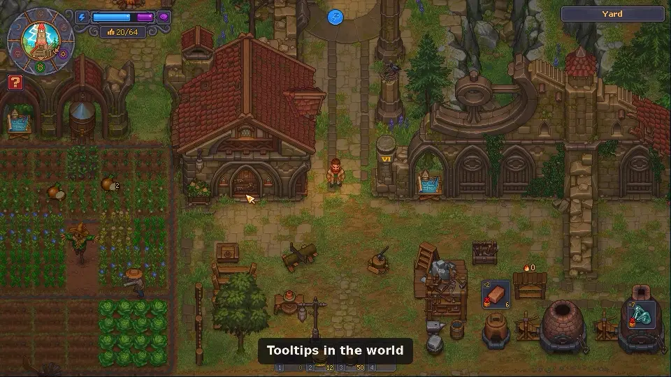
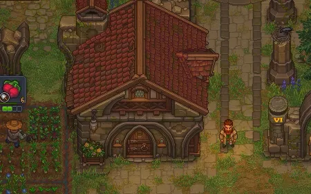
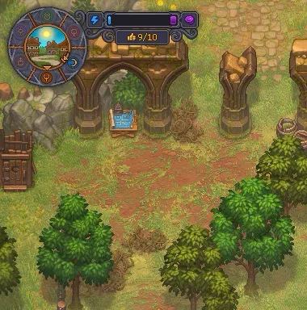

<p align="center">
  
</p>

<p align="center">
  Quality-of-life mods for <b>Graveyard Keeper 2</b>, in one plugin.<br>
  More numbers, more context, a better map and a calendar. It looks like the game made it.<br>
  <sub>English and Brazilian Portuguese, following the game's language.</sub>
</p>

<p align="center">
  <a href="https://steamcommunity.com/sharedfiles/filedetails/?id=3842328876"><b>Steam Workshop</b></a> ·
  <a href="#features"><b>Features</b></a> ·
  <a href="#install"><b>Install</b></a> ·
  <a href="#after-a-game-update"><b>Game updates</b></a> ·
  <a href="#how-it-is-built"><b>How it is built</b></a>
</p>

<table>
  <tr>
    <td width="25%" valign="top"><b>Looks native</b><br>Built from the game's own UI: same fonts, frames, colors and pixel grid.</td>
    <td width="25%" valign="top"><b>No spoilers</b><br>Shows only what your save has already revealed, checked against what unlocks what in the game.</td>
    <td width="25%" valign="top"><b>Information first</b><br>Nothing changes the rules by default. The two features that do ship turned off.</td>
    <td width="25%" valign="top"><b>Toggles live</b><br>Every feature turns on and off from the pause menu, without restarting.</td>
  </tr>
</table>

<p align="center">
  
</p>

## Features

### Map

**Zoom.** Mouse wheel zoom in four pixel-perfect levels, anchored on the cursor. One more step goes down to the world itself. The map only shows what you have explored.

<p align="center"></p>

**Look inside places.** Zoom into a yellow arrow to peek inside a place you have visited. Doors and stairs lead further in, and hovering an object inspects it.

<p align="center"></p>

**Order details.** Hover the town orders icon to see the item of each order, how much is delivered and the reward.

<p align="center"></p>

### Tooltips

**Richer tooltips.** Hovering shows the essentials. Middle click pins the tooltip and opens the details: the recipe in item cells, where it is used, costs per tick. Highlighted terms open another tooltip inside it. The key can be changed in the game's Controls window.

<p align="center"></p>

**Tooltips in the world.** Rest the mouse on a craft, a garden bed or a body to see what is being made, the game's own progress cells and how long is left. Pinned, it follows the object and adds the queue, the harvest so far and the fuel.

<p align="center"></p>

**Quest tree.** NPC names on the quest tree. Click a quest to read how you got there.

<p align="center"></p>

### Calendar and journal

**Time and week on the medallion.** Hover the day medallion to see the time and the week ahead. Hover a sigil for that day.

<p align="center"></p>

**Week as a carousel.** Optional: the same week in one row that slides as the day goes by.

<p align="center"></p>

**Calendar tab.** A calendar page in the TAB window, with the days and their events.

<p align="center"></p>

**Journal.** A diary of what you unlocked and finished each day.

<p align="center"></p>

### HUD

**HUD numbers.** Numbers on the energy and insanity bars.

<p align="center"></p>

**Show the maximum.** Optional: the maximum too, like 120/150.

<p align="center"></p>

**Day plate.** Optional: a small plate with the day and time under happiness.

<p align="center"></p>

**Turning day medallion.** The day medallion turns slowly as the hours pass.

<p align="center"></p>

### Gameplay, off by default

These two change the state of the game, so they start turned off.

**Save and Load in the pause menu.** The game only saves when you wake up. Save works whenever the game is free (no dialog, fight, sleep or work going on). Load lists the current save, the game's backups and the mod's own history.

<p align="center"></p>

**Zombie perk refund.** Right-click a bought zombie perk to get its points back, one perk at a time.

<p align="center"></p>

### The menu

A **GK2 HUD+** button in the pause menu opens the list of features. Each one has a short clip of itself in action and
turns on or off on the spot. Settings live in `BepInEx/config/mullervgs.gk2.hudplus.cfg`.

<p align="center"></p>

## Install

Graveyard Keeper 2 ships its own mod loader (BepInEx 5), so there is nothing else to install.

**Steam Workshop** (recommended): subscribe to [GK2 HUD+ on the Workshop](https://steamcommunity.com/sharedfiles/filedetails/?id=3842328876) and start the game. The game installs and updates the mod by
itself.

**Manual**:

1. Download `GK2HudPlus-<version>.zip` from [Releases](../../releases).
2. Unzip it into the game's save data folder, so that you end up with
   `%USERPROFILE%\AppData\LocalLow\Lazy Bear Games\Graveyard Keeper 2\Mods\Code\GK2HudPlus\modinfo.json`.
3. Start the game.

Either way, the mod shows up in the game's Mods window and as a **GK2 HUD+** button in the pause menu.

Steam Deck and Linux (Proton): set the game's launch options to `WINEDLLOVERRIDES="winhttp=n,b" %command%`, as the
game asks for any BepInEx plugin.

To remove it, unsubscribe or delete the `GK2HudPlus` folder. Your settings stay in `BepInEx/config`.

## After a game update

Each feature runs isolated: if a game update breaks one, that feature turns itself off with an in-game notice and the
rest keeps working. Turn it off and on again in the menu to retry, and please [open an issue](../../issues) with your
`Player.log`.

## How it is built

The repository is also a record of how the mod is made, almost entirely by AI coding agents working against a second
copy of the game. The full guide the agents follow is in [AGENTS.md](AGENTS.md) (in Portuguese).

- **Blue-green.** *Blue* is the copy being played; *green* is an isolated copy (own saves, own registry key) where
  agents build and test. A mod only reaches blue after its screenshots are approved.
- **A bridge into the game.** A development-only plugin exposes the running game over local HTTP: hot-reload a
  build in about 2 seconds, run C# scenarios inside the game, dump the native UI tree, take screenshots.
- **Screenshots or it did not happen.** Every visible change ends with a screenshot judged against the native screen it
  imitates: font, 2 px grid, 9-slice frames, palette, spacing.
- **Spoiler barrier.** `gk2 check` indexes every script and dialogue graph of the game to know what unlocks what, and
  fails the build if the mod could show something the save has not revealed.
- **Clips that cannot go stale.** The clips on this page and in the in-game menu are recorded by scripted demos. Each
  one is tied to the hash of the code it shows; change the code and the build fails until the clip is re-recorded.
- **Measured cost.** Frame time, GC and the cost of each feature go to a metrics dashboard. HUD+ takes about 0.5% of a
  frame.

| Project | What |
| --- | --- |
| `GK2HudPlus/` | **GK2 HUD+**: the package, with the feature list and the menu |
| `GK2Hud/` | tooltips, HUD numbers, medallion, calendar, journal, quest tree |
| `GK2Map/` | map zoom, place view, inspection, orders |
| `GK2Saves/` | Save and Load in the pause menu, save history |
| `GK2ZombieRefund/` | zombie perk refund |
| `GK2Insight/` | debug tool: in-game panels, data dump and telemetry (not part of the package) |
| `GK2DevBridge/`, `GK2HotLoader/` | development bridge and live delivery of approved builds |
| `Shared/` | ModGuard (isolated parts), ModHost (feature list), plugin swap at runtime |
| `tools/` | `gk2` CLI, clip recorder, spoiler check, game update routine |
| `docs/cenarios/` | C# scenarios run inside the game |

## Build from source

Needs the game, Docker and a Linux shell (developed on WSL). `tools/gk2` builds against the game's assemblies inside
a .NET SDK container; paths to the game are at the top of the script.

```
gk2 package GK2HudPlus     # dist/GK2HudPlus-<version>.zip
```

## License

[MIT](LICENSE). The font used in the trailer captions (Jersey 10) is under the SIL Open Font License, in
`tools/rec/fonts/`.

## Disclaimer

Unofficial fan project, not affiliated with Lazy Bear Games. Graveyard Keeper 2 and its art belong to their owners;
the clips here show the game with the mod running.
